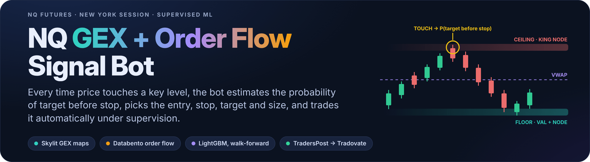
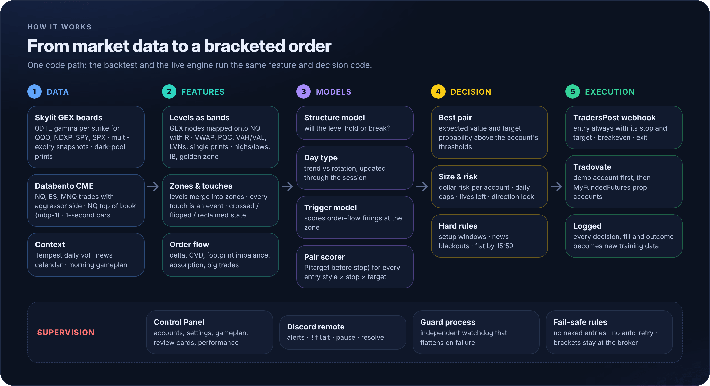
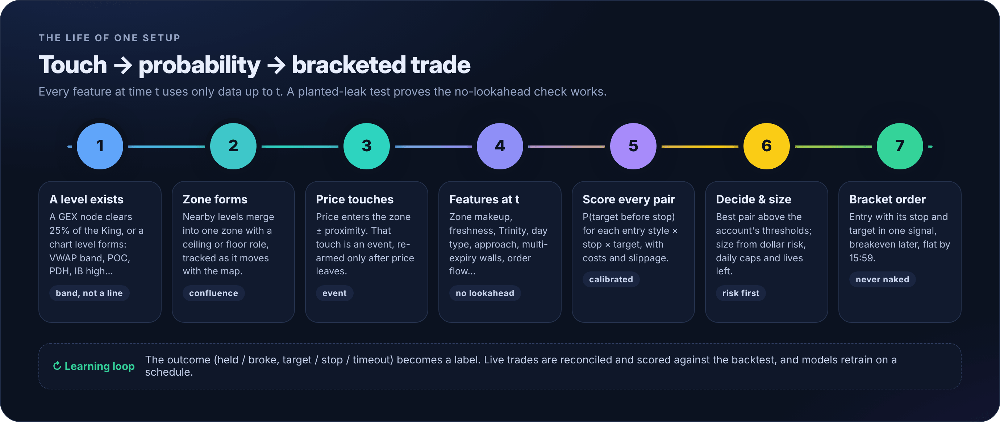
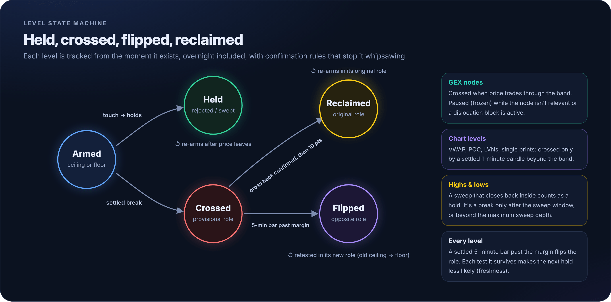
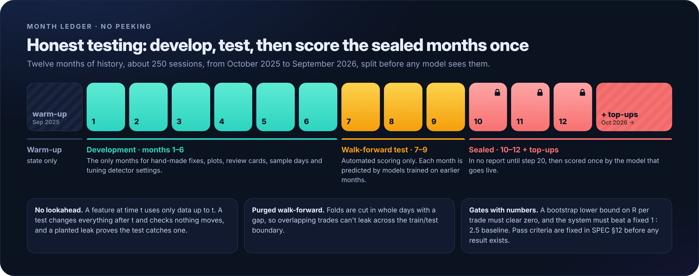
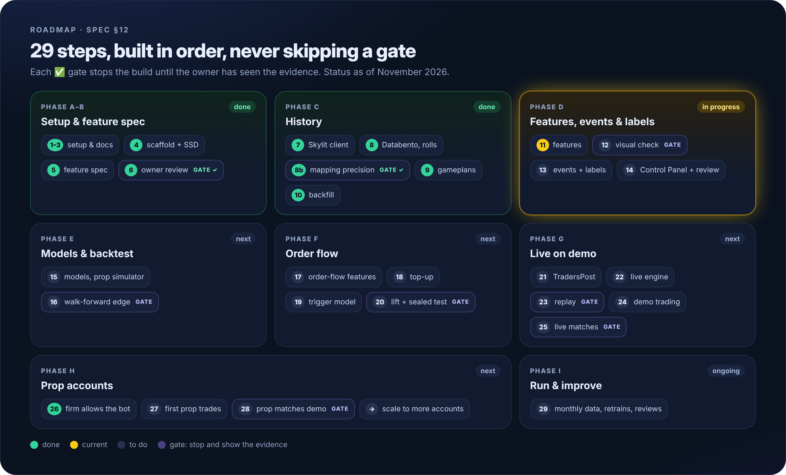
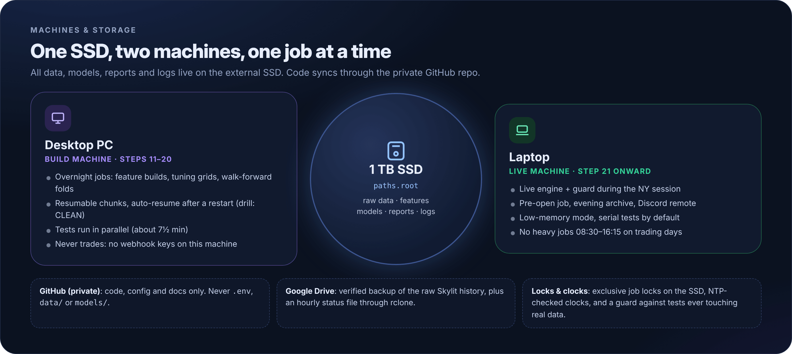

<p align="center">
  
</p>

<p align="center">
  
  
  
  
</p>

A supervised ML bot for **Nasdaq-100 futures (NQ)**. Every time price touches a key level during the New York session, it estimates **the probability that the target is hit before the stop**, picks the entry, a structural stop, the target, the size and the breakeven rule, and sends the trade automatically through **TradersPost → Tradovate**. A local **Control Panel** and a **Discord** remote are used to monitor the bot.

> **Source of truth:** [`docs/SPEC.md`](docs/SPEC.md) defines how everything works, and [`docs/feature_spec.md`](docs/feature_spec.md) defines every feature exactly. [`CLAUDE.md`](CLAUDE.md) holds the working rules and the current status.

---

## Contents

- [How it works](#how-it-works)
- [The life of one setup](#the-life-of-one-setup)
- [Levels and their states](#levels-and-their-states)
- [Models](#models)
- [Risk and execution safety](#risk-and-execution-safety)
- [Honest testing](#honest-testing)
- [Roadmap and status](#roadmap-and-status)
- [Machines and storage](#machines-and-storage)
- [Getting started](#getting-started)
- [Repository layout](#repository-layout)
- [Ground rules](#ground-rules)

---

## How it works



**The core idea:** options dealers' gamma exposure (**GEX**) creates price levels where the market tends to react. The bot maps those levels from the option chains (QQQ, NDXP, SPY, SPX) onto the NQ and ES futures charts. It combines them with classic auction levels (VWAP, volume-profile POC and value area, single prints, prior highs and lows, the initial balance, the opening-range golden zone) and reads the **order flow** at each touch to determine whether to enter or not.

| Source | What the bot uses |
|---|---|
| **Skylit** | 0DTE gamma per strike (intraday boards), multi-expiration snapshots, Tempest daily volatility, dark-pool prints (not in the first model) |
| **Databento (CME)** | NQ, ES and MNQ trades with the aggressor side, NQ top of book (`mbp-1`), 1-second bars, contract rolls |
| **Context** | high-impact news calendar, a morning gameplan (parsed by an LLM), holidays and early closes |

**One code path:** the backtest and the live engine run *the same* feature and decision code.

---

## The life of one setup



- **Bands, not lines.** Every level is a price band. GEX strikes are converted to futures prices with the ratio *R* = futures ÷ underlying.
- **Zones.** Nearby levels merge into a zone. The zone moves with the map, and a stable `zone_id` lets the bot recognise it after it moves.
- **Events.** One touch of a zone is one event. Events created by the same touch form a *touch group*: weighted as one in training and traded at most once.
- **Pairs.** For each event the bot scores every *entry style × stop × target* combination and takes the highest-EV pair whose expected R and target probability clear the account's thresholds.

---

## Levels and their states



| Family | Examples | Crossed when |
|---|---|---|
| **GEX nodes** | King, gatekeepers, ceilings/floors, pika and barney nodes | price trades past the band's far edge |
| **Chart levels** | VWAP and bands, POC, previous-session VAH/VAL, LVNs, single prints | a settled 1-minute candle beyond the band (single prints also end when filled) |
| **Highs and lows** | PDH/PDL, overnight, IB, prior week, retested extremes | only after the sweep window passes without a reclaim, or beyond the maximum sweep depth |

A settled **5-minute** bar past the margin **flips** a level: broken resistance becomes support. **Freshness** tracks how often a level has been tested: each test it survives makes the next hold less likely. **Trinity** (SPY, SPX and the Nasdaq side each holding a node in the same role at price) is a confluence feature, not a level.

---

## Models

| Model | Predicts | Notes |
|---|---|---|
| **Structure** | will the level hold or break? | LightGBM, with a logistic-regression baseline for comparison |
| **Day type** | trend vs range day, through the session | regularised logistic regression on 8 fixed inputs, a snapshot every 15 minutes from 10:00 |
| **Trigger** | quality of an order-flow firing at the zone | absorption, exhaustion, delta divergence, imbalance (step 19) |
| **Pair scorer** | **P(target before stop)** for each entry × stop × target | the final model; calibrated; drives the decision |

Entry styles: **(a)** absorption, **(b)** another order-flow trigger, **(c)** a sweep or audit reclaim at the zone edge, **(d)** plain at the touch.

**ML decides.** There are no hand-written "if X then trade" rules. Hard rules exist only for risk limits, setup windows, news blackouts and the owner's structural definitions.

---

## Risk and execution safety

- **Never a naked entry.** Every entry carries its stop and target.
- **Never an automatic retry of an entry**, and never `reverse` or `cancel`. Pending orders are removed with `exit`.
- **One trade per account at a time**, each order with a unique `order_id`.
- **Direction lock:** all prop accounts point the same way (no hedging across accounts).
- **News flatten:** flat 30 minutes before each high-impact release; no new entries until 60 minutes after.
- **Failure handling:** a feed, clock, Skylit or SSD failure means no new entries and pending entries removed, while the brackets stay at the broker. An independent **guard** process sends the protective exits too.
- **Flat by 15:59 ET** (earlier on early-close days), with dollar risk per trade, daily caps and drawdown "lives" tracked per account.
- **Prop rules specified exactly** (MyFundedFutures Rapid EOD, Builder and Pro; SPEC §6.7): end-of-day trailing drawdown, consistency caps, daily loss limits and payout rules, for the prop simulator (step 15) and live sizing (step 22).

---

## Honest testing



- **No lookahead.** A feature at time *t* uses only data up to *t*. The test suite changes or removes everything after *t* and checks that nothing at *t* moves, and a **planted leak** proves the check would catch one.
- **Purged walk-forward.** Every test month is predicted by models trained only on earlier months; folds are cut in whole days with a gap, so overlapping trades can't leak across the train/test boundary.
- **Sealed months** are kept out of every report until step 20, then scored **once** by the model that goes live.
- **Gates with fixed rules.** Each gate's pass criteria are written in SPEC §12 before any result exists, its numbers in `config/settings.yaml` → `gates` (e.g. at step 16 the bootstrap lower bound on R per trade must clear zero, the system must beat a fixed 1 : 2.5 baseline, and calibration error must stay under `gate_calib_max`). Every passed gate is recorded in `config/gate_record.json`.
- **Feature freeze** until gate 16. New ideas wait in SPEC §13 (Q-v2).

---

## Roadmap and status



**Now:** step 11 (features) is done: the full 12-month feature build (`feature_build`, 251 sessions, about 15½ hours over two runs on the build PC) finished on 2026-11-02 (the roadmap image above still marks step 11 as current). Next is the step-12 visual check of the chart levels against Deepcharts (a ✅ gate). The live status is always in [`CLAUDE.md`](CLAUDE.md) → *Status*.

---

## Machines and storage



- **All project data** (`data/`, `models/`, `reports/`, logs) lives on the external SSD under `paths.root`, never in git and never on an internal drive (one exception: a session recording falls back to the internal drive if the SSD fails, and is moved over after the close).
- **Long jobs** run through `nqbot run <job> --until 07:30`: resumable chunks, low-memory mode, and they keep Windows awake; on the build PC the scheduled `nqbot resume` task restarts queued jobs after a reboot. A job runs only on a commit whose full test pass is recorded.
- **Per-machine settings** (`max_workers`, `low_memory`, `test_parallel`, `rclone_path`, …) go in the uncommitted `config/local.yaml` (see `config/local.example.yaml`).

---

## Getting started

Windows, Python via **[uv](https://docs.astral.sh/uv/)**. Run everything from the repo root.

```powershell
uv sync                      # install from the committed uv.lock
copy .env.example .env       # then fill in your own keys (never commit .env)
uv run nqbot test            # full test suite (parallel only where local.yaml says test_parallel: true)
uv run nqbot status          # SSD, job locks, job progress, queue, clock
uv run nqbot preflight       # power, clock, SSD, Windows Update checks
```

**Everyday commands**

| Command | What it does |
|---|---|
| `uv run nqbot run <job> --until 07:30` | run a long job in resumable chunks |
| `uv run nqbot stop <job>` | stop a job cleanly after the call it is in, its answer saved (never Ctrl+C a paid pull) |
| `uv run nqbot queue add <job>` / `queue release [<job>]` | queue work for the `nqbot resume` task / lift a hold |
| `uv run nqbot verify --since YYYY-MM-DD` | check the SSD's files for damage |
| `uv run nqbot features plan --months 1-12` | plan the feature build, then `run feature_build --until 07:30` |
| `uv run nqbot gameplan <file>` | parse today's gameplan with the Claude API (prints its cost first) |
| `uv run nqbot keys-check` | one free call per service (Skylit, Databento, Anthropic, Discord) to check this machine's keys |
| `uv run nqbot ui` | Control Panel *(step 14, not built yet)* |
| `uv run nqbot live` | live engine + guard *(step 22, not built yet)* |

The complete, current list is in [`CLAUDE.md`](CLAUDE.md) → *Commands*.

---

## Repository layout

```text
config/         settings.yaml · features.yaml · accounts.yaml · calendar.yaml · gate_record.json · local.example.yaml
docs/           SPEC.md · feature_spec.md · owner_notes.md · gameplan_glossary.md · skylit/ · design/ · readme/
src/nqbot/      cli · clients/ (Skylit, Databento) · features/ · gameplan/ · checks/ · jobs/ · risk
                (models/, backtest/, detectors/, events/, live/, ui/: placeholders for later steps)
scripts/        Windows task wrapper · task registration · time-sync fix
tests/          unit tests with hand-built examples and the no-lookahead tests (replay tests: step 23)
.githooks/      pre-commit repo guard (no tracked file over 1 MB)
```

---

## Ground rules

- **Secrets** live only in `.env`. Never commit `.env`, `data/` or `models/`.
- **Personal use only.** Market data, levels and alerts are never shared or redistributed.
- **Money:** every paid pull prints its cost first; purchases, paid pulls and large credit pulls need the owner's OK; pulls are cached and never repeated.
- **Changes:** an owner-approved change updates `docs/SPEC.md` in the same session; feature changes bump `features_version` and rebuild.
- **Scope:** NQ only. This is not financial advice, and trading futures carries substantial risk of loss.
